# 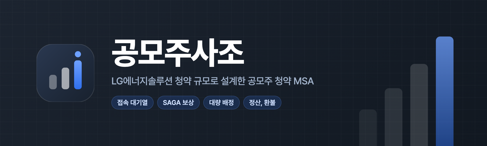

> 공모주 청약, 해보셨나요?  
> 청약이 시작되면 수많은 신청이 한꺼번에 집중돼요.  
> 공모주사조는 이런 상황에서도 청약을 안정적으로 접수하고, 증거금과 원장의 정합성을 지키도록 설계했어요.  
> 2022년 LG에너지솔루션 청약 규모(KB증권 212만 건)를 기준으로 직접 검증했어요. 📈

<br>

## Overview

<p align="center">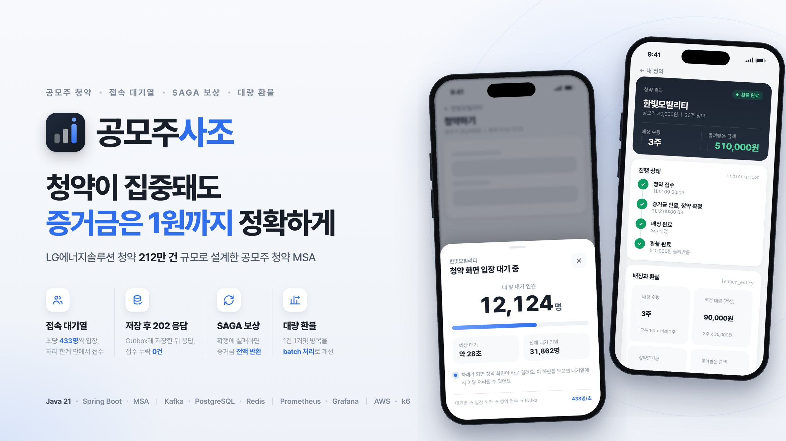</p>

- 오픈 직후 피크인 초당 433건에서 3회 측정 모두 오류 0%, 신청 → 확정 p95 1.20초
- 마감 직전 초당 274건이 접수돼도, 마감 시각 전에 도착한 청약은 모두 배정 대상에 포함됩니다 (누락 0건)
- 212만 건 배정은 마감부터 완료까지 5분 24초 걸립니다 (실측)

<br>

## Main Features

### 1. 접속 대기열
- 청약이 집중되면 1초마다 433명씩 입장을 허가하고, 내 앞 대기 인원과 예상 대기 시간을 안내합니다.
- 입장 허가가 없는 청약 신청은 게이트웨이가 403으로 차단합니다.

<p align="center">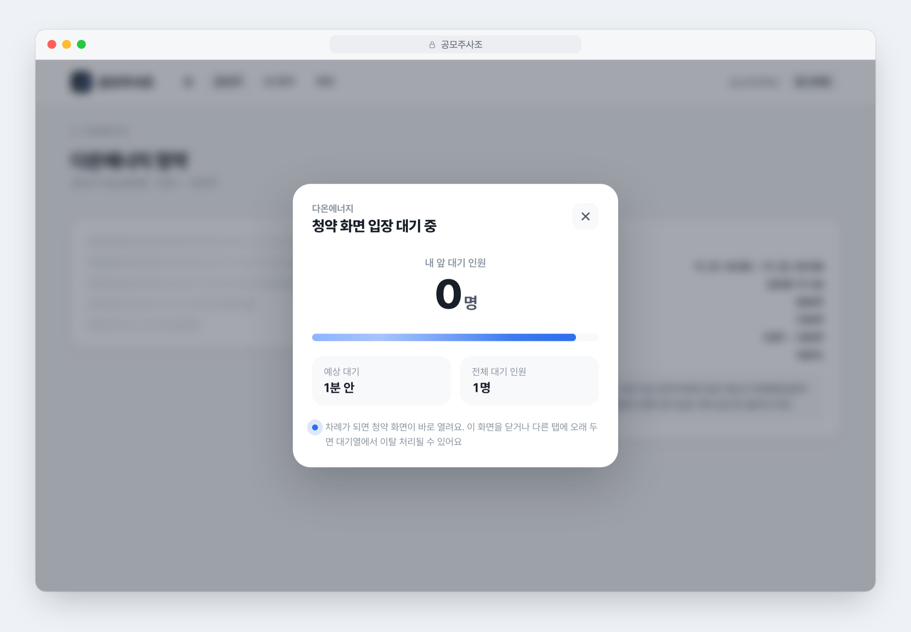 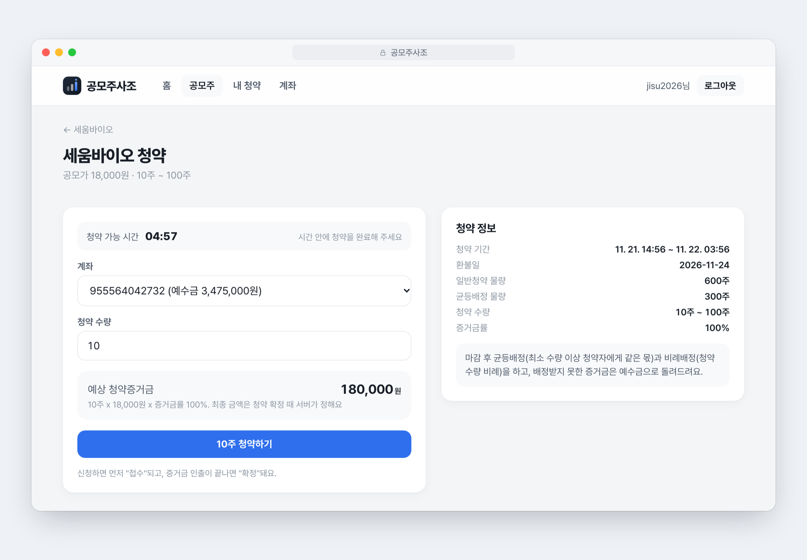<br><sub>왼쪽 대기 화면 (내 앞 대기 인원, 예상 대기 시간), 오른쪽 청약 화면 (청약 가능 시간 5분, 예상 청약증거금)</sub></p>

### 2. 청약과 SAGA 보상
- 청약은 202로 바로 응답하고, 증거금 인출 → 확정까지 이벤트로 처리합니다. 예수금이 부족하면 거절, 확정에 실패하면 증거금을 반환합니다.
- 계좌 서비스 장애 주입 테스트에서 증거금 유실, 중복 인출 0건

<p align="center">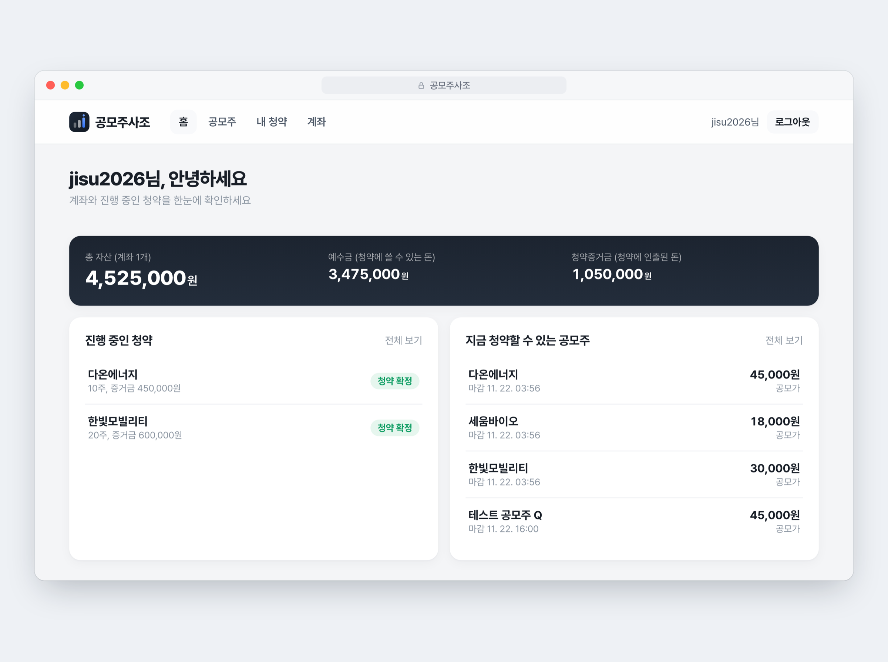 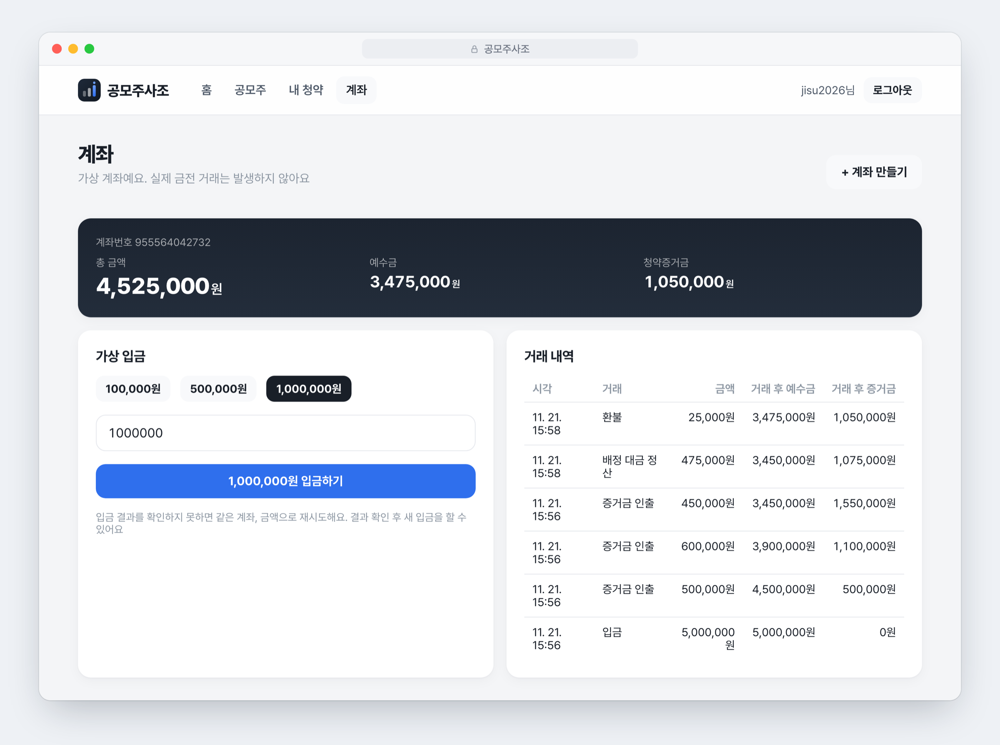<br><sub>왼쪽 홈 (예수금, 청약증거금, 진행 중인 청약), 오른쪽 계좌 (입금 → 증거금 인출 → 배정 대금 정산 → 환불)</sub></p>

### 3. 배정, 정산, 환불
- 마감 후 균등, 비례, 추첨, 단주 순서로 배정하고, 배정 대금만 정산한 후 남은 증거금은 예수금으로 환불합니다.
- 추첨 시드를 기록해 관리자가 같은 결과를 다시 계산해 확인합니다 (10만 건 불일치 0건).

<p align="center">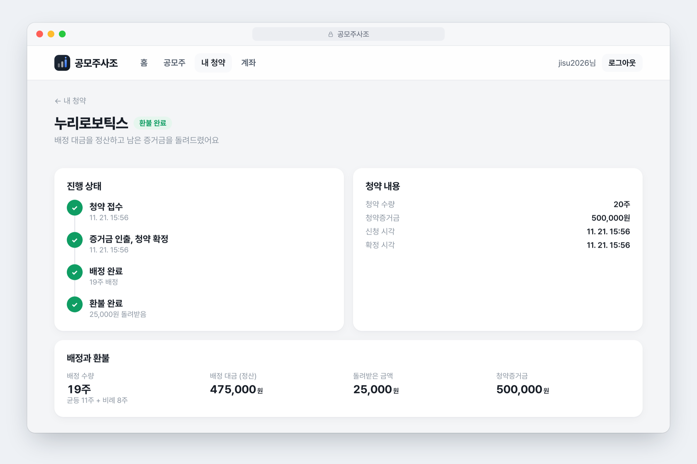<br><sub>배정 결과: 균등 11주 + 비례 8주, 배정 대금 정산 후 남은 증거금 환불</sub></p>

### 4. 원장 정합성
- 잔고를 바꾸는 메서드가 원장을 함께 생성해 반환하므로, 원장 없이 잔고만 바뀌는 코드 경로가 없습니다.
- 같은 요청, 같은 이벤트는 requestId와 이벤트 처리 기록(processed_event)으로 1회만 반영합니다.
- 측정이 끝날 때마다 검증식 SQL 26개를 실행했고, 36회 모두 위반 0건

<p align="center"><br><sub>청약 1건의 Kafka 이벤트 4개와 원장 3줄 (시연용 운영 조회 화면, 배포 미포함)</sub></p>

### 5. 운영과 관측
- 서비스 종료, 5xx, DLT 적재 등 7가지 장애를 Slack으로 알리고, Zipkin과 Loki로 요청 흐름과 로그를 추적합니다.
- CI를 통과한 커밋만 EC2에 HTTPS로 자동 배포합니다.

<p align="center">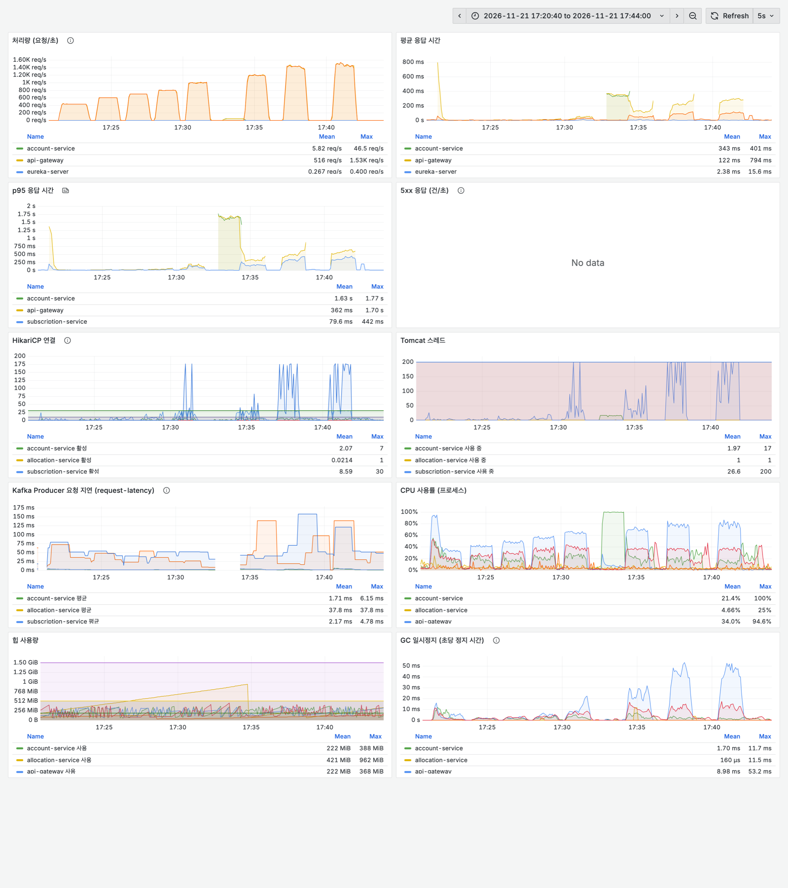 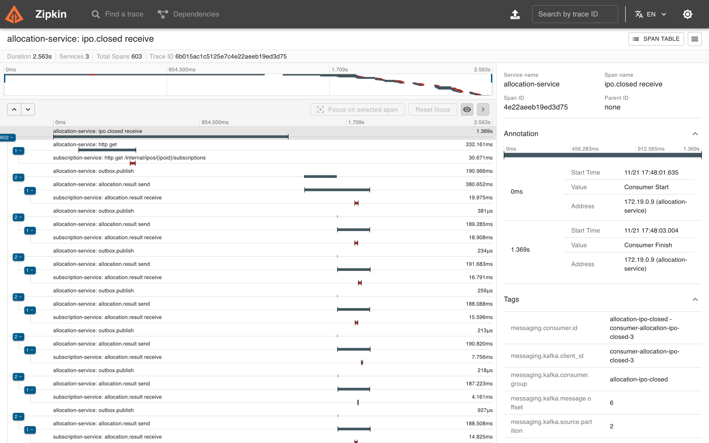<br><sub>왼쪽 Grafana 측정 대시보드 (처리량, 응답 시간, 커넥션, CPU, 힙, GC), 오른쪽 Zipkin 분산 추적 (마감 → 배정 → 청약 결과 수신)</sub></p>

<details>
<summary>운영 화면 더 보기 (알림 규칙, 시스템 현황)</summary>
<br>

<p align="center"><br><sub>Grafana 알림 규칙 7종</sub></p>

<p align="center">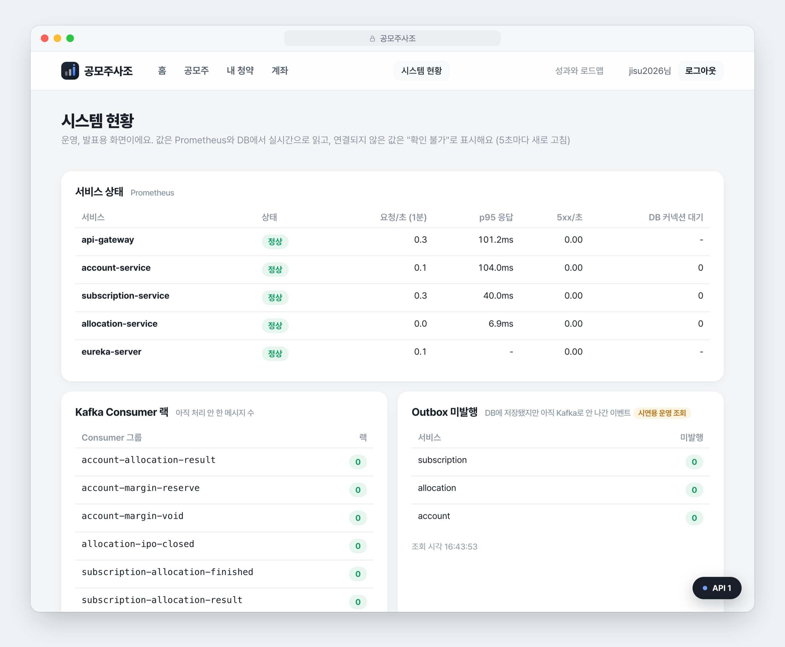<br><sub>시스템 현황 (시연용, 배포 미포함)</sub></p>

</details>

<br>

## Architecture


1. 사용자는 Route 53으로 도메인을 조회한 후 Elastic IP로 요청합니다. Caddy가 80번 요청을 443(HTTPS)으로 전환하고, 인증서는 Let's Encrypt에서 자동 발급, 갱신합니다.
2. Gateway가 JWT를 검증하고 접속 대기열(Redis)로 입장을 허가한 후, Eureka에서 서비스를 조회해 라우팅합니다.
3. 청약은 DB 저장 후 202로 응답하고, 이벤트는 Outbox로 Kafka에 발행합니다. 마감 후 배정 서비스가 Feign으로 확정 청약 목록을 조회합니다 (Timeout, Circuit Breaker).
4. PostgreSQL 1개에 서비스별 스키마와 전용 계정을 분리했습니다. Kafka는 KRaft 단일 브로커, 토픽 9개 + DLT 9개, 파티션 6개입니다.
5. 지표, trace, 로그를 수집하고, Grafana 장애 알림 7종을 Slack으로 발송합니다. 대시보드는 외부에 열지 않고 SSM 포트 포워딩으로만 접속합니다.
6. CI를 통과한 커밋만 이미지를 빌드해 ECR에 올리고, SSM Run Command로 서버에서 배포 스크립트를 실행합니다.

<details>
<summary>자원 할당, 한계</summary>
<br>

**서비스별 자원 할당** (`compose.perf.yml`)
- 청약, PostgreSQL 각 2.0코어 / 1GiB
- 계좌, 게이트웨이, Kafka 각 1.0코어 / 1GiB
- 배정 0.5코어 / 2GiB (힙 1.5GiB), web 0.5코어 / 256MiB
- 나머지 0.25-0.5코어, 상한 합계 CPU 11.25코어 (EC2 8 vCPU)

**한계**
- EC2 1대라 단일 장애점 (ALB, Auto Scaling 없음)
- Kafka 단일 브로커, 복제본 없음
- PostgreSQL도 같은 EC2의 컨테이너 (RDS 없음)
- 인증서는 caddy-data 볼륨에 저장 (삭제 시 재발급, 같은 도메인 주 5회 한도)

</details>

<details>
<summary>상세 인프라 구성도 (포트, 역할, 배포 검증 포함)</summary>


</details>

<details>
<summary>시스템 구조도</summary>

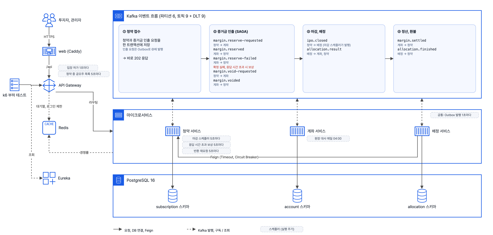

- 실패 처리(발행 누락, 중복 수신, DLT, SAGA 보상, 동기 호출 장애): [청약 SAGA 실패 시나리오](docs/scenario/saga-failure.md), [장애 대응 절차](docs/scenario/incident-response.md)

<details>
<summary>상세 시스템 구조도 (서비스별 설명, 장애 대응 설계, 운영 포함)</summary>


</details>

</details>

- **api-gateway**: JWT 인증, 라우팅, 접속 대기열
- **subscription-service**: 공모주, 청약 접수, SAGA 오케스트레이션, 마감
- **account-service**: 회원, 계좌, 증거금, 원장, 원장 대사
- **allocation-service**: 배정 계산, 추첨 재현

서비스마다 스키마와 DB 계정을 분리했습니다. 동기 호출은 배정 → 청약 확정 목록 조회 1곳이고, Timeout과 Circuit Breaker를 적용했습니다.

**청약 한 건이 처리되는 순서**

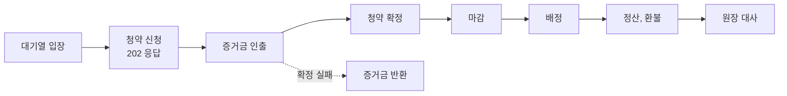

청약, 계좌, 배정 3개 서비스가 Kafka 이벤트로 연결되고, 청약 서비스가 SAGA 오케스트레이터로 증거금 인출, 확정, 반환을 지시합니다. 202 응답 전에 청약과 증거금 인출 요청을 한 트랜잭션에 저장합니다 (Transactional Outbox).

<br>

## Performance

PC 1대에서 서비스, DB, Kafka, k6를 Docker로 실행하고 컨테이너 자원 상한을 고정해, 같은 조건 3회 중앙값으로 비교했습니다.

피크 부하는 실제 접수 건수로 계산했습니다. 접수의 20%가 10분에 집중된다고 가정하면 오픈 직후 433건/초(첫날 1,299,764건), 마감 직전 274건/초(마감일 822,603건)입니다.

| 개선 | 전 | 후 | 방법 |
| --- | ---: | ---: | --- |
| 433건/초 신청 → 확정 p95 | 54.5초 | **1.4초** | 파티션, Consumer 3 → 6 |
| 마감 처리 시간 | 43.3초 | **22.4초** | 접수 Outbox |
| 10만 건 정산, 환불 구간 | 92.9초 | **58.4초** | batch 리스너 + 건별 flush, clear |
| 배정 처리 규모 | 30만 건 미완료 | **212만 건 5분 24초** | 키셋 조회, 1만 건씩 저장 |
| 배정 결과 커밋 (3만 건) | 11.3초 | **3.0초** | JDBC batch INSERT |
| 경쟁률 조회 중 청약 p95 | 29.0초 | **70ms** | Redis 경쟁률 캐시 |
| 장애 후 반환 대기 청약 | 60-79건 | **0건** | 반환 재요청 백오프 |

600건/초는 확정 처리 한계(약 510건/초)를 초과해, 계속 받아도 지연되지 않는 433명/초로 입장 속도를 결정했습니다. 433-600건/초 사이는 측정하지 않았습니다.

<br>

## Troubleshooting

<details>
<summary><b>batch로 바꿨는데, 정산 시간이 오히려 19.4% 증가했다</b></summary>
<br>


- **문제**: 정산 Consumer가 1건마다 커밋해 WAL 쓰기 대기 비율 27.6%
- **시도**: 100건을 한 트랜잭션으로 처리하는 batch 리스너로 변경 → 정산 구간 93.6초 → 111.8초
- **원인**: JFR CPU 샘플의 77.4%가 Hibernate flush
  - 쿼리마다 실행되는 자동 flush가 배치에 누적된 엔티티 전체를 매번 변경 감지
  - batch size 500에서 315.8초, 비용이 건수 제곱에 비례
- **해결**: 1건 처리 후 flush, clear 추가, 커밋은 배치당 1번 유지
- **결과**: 10만 건 정산 구간 92.9초 → 58.4초, 212만 건 추정 40분 51초 → 28분 58초
</details>

<details open>
<summary><b>CPU를 2배로 늘렸는데, 확정 지연은 왜 그대로일까?</b></summary>
<br>
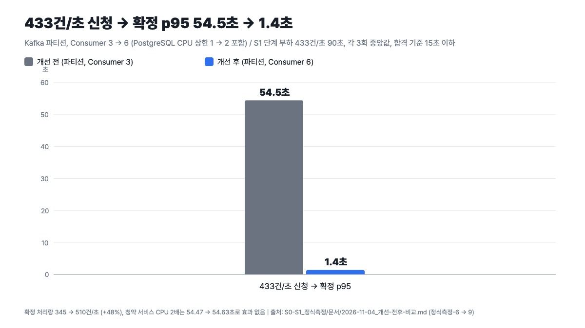

- **문제**: 433건/초에서 신청 → 확정 p95 54.5초
- **확인**: 청약 서비스 CPU 상한을 2배로 늘려도 54.63초로 변화 없음
  - 요청 종료 후 남은 메시지만 처리하는 구간에서도 CPU 여유가 있는데 처리 속도 동일
- **원인**: 동시 처리 수 (파티션 3, Consumer 3)
- **해결**: 한 번에 하나씩 변경하며 측정
  - PostgreSQL CPU 상한 1 → 2: 확정 280 → 345건/초
  - 파티션, Consumer 3 → 6: 510건/초
- **결과**: 확정 p95 54.5초 → 1.4초, 확정 처리량 +48%
</details>

<details>
<summary><b>30만 건에서 멈추던 배정, 212만 건까지</b></summary>
<br>


- **문제**
  - 30만 건: 결과 1건 약 1.8KB를 커밋까지 메모리에 보유해 힙 부족
  - 50만 건: offset 조회가 페이지당 최대 12초로 지연돼 Kafka 처리 한도 5분 초과
- **검토한 대안**
  - 힙만 증설: 212만 건에 약 3.8GB 필요
  - 1만 건마다 커밋: 중간 실패 시 결과 일부만 발행
  - 계산까지 분할: 추첨 결과가 달라져 재현 불가
- **해결**: 계산은 한 번에, 저장만 1만 건씩 DB 반영 후 비우고 커밋은 1번 유지
  - 조회는 키셋 방식으로 변경
- **결과**: 212만 건 5분 24초, 중간 실패 시 전체 롤백, 추첨 재현 결과 동일
</details>

<details>
<summary><b>경쟁률 조회 하나로 청약 응답 p95가 29초까지?</b></summary>
<br>

- **문제**: 경쟁률을 조회마다 DB에서 합산, 청약과 목록 조회를 동시에 거는 시나리오에서 청약 p95 29.0초
- **원인**: 합산 쿼리 평균 421ms
  - PostgreSQL CPU 상한 도달
  - 청약 서비스 커넥션 30개 모두 사용 중
- **해결**: 경쟁률을 Redis 캐시에서 조회하도록 분리, 기준은 DB 유지
  - 캐시가 비면 DB로 다시 계산
  - Redis 장애에도 청약 접수는 그대로 동작
- **결과**: 청약 p95 29.0초 → 70ms, 지연된 요청 64,719건 → 0건
</details>

<details>
<summary><b>장애는 복구됐는데, 증거금은 반환되지 않았다</b></summary>
<br>

- **문제**: 계좌 서비스의 반환 처리만 약 8분 실패시키자 청약은 COMPENSATING, 증거금은 PENDING으로 남음
- **원인**: 반환 재요청 3회가 장애 시간 안에 모두 실패
- **해결**: 횟수 제한 대신 30초부터 5분 간격까지 증가시키며 응답까지 재요청
  - 반환은 결국 성공해야 하는 작업이라 횟수 제한 제외
  - 5회 이상이면 반환 지연 알림 발송
- **결과**: 반환 대기 청약 60-79건 → 0건, 장애 해제 후 64-66초 안에 전부 반환
</details>

<details>
<summary><b>대기열에서 사라진 입장 순번, 원인은 명령 순서</b></summary>
<br>

- **문제**: Redis 메모리 상한에서 대기자가 입장 허가 없이 대기열에서 삭제됨
- **원인**: 입장 처리 Lua 스크립트 순서가 대기열에서 꺼내기(ZPOPMIN) → 허가 저장(SET)
  - 메모리 상한에서 SET만 거부되고 이전 명령은 롤백되지 않음
- **해결**: 허가 저장(SET) → 대기열에서 제거(ZREM) 순서로 변경
  - 실패하면 대기자가 대기열에 그대로 유지
- **결과**: 원래 순서로 되돌리면 테스트가 실패하는 것 확인
</details>

<br>

## Tech Stack

     
     
    
    
      
     
 

<br>

## ERD

<div align="left">
  
</div>

<br>

## Getting Started

```bash
cp .env.example .env          # DB 비밀번호, JWT_SECRET 입력
./gradlew build -x test && docker-compose up -d --build
cd frontend && npm install && npm run dev   # http://localhost:5173
```

통합 Swagger `localhost:8080/swagger-ui/index.html`, Grafana `localhost:3000`, Kafka UI `localhost:8989`, Zipkin `localhost:9411`

자세한 내용은 [프로젝트 세팅 가이드](docs/PROJECT_SETUP.md), [부하 테스트 가이드](docs/LOADTEST.md), [유비쿼터스 언어](docs/UBIQUITOUS_LANGUAGE.md), [GitHub 협업 가이드](docs/GITHUB_GUIDE.md)

<br>

## Contributors

| [한지수](https://github.com/eldeoddt) | [김진우](https://github.com/Kimjinwoo99) | [이승훈](https://github.com/tcrnela) | [이창열](https://github.com/askl690) | [최승근](https://github.com/choiseungkeun) |
| --- | --- | --- | --- | --- |
|  |  |  |  |  |
| `Team Lead`<br>**계좌**<br>- 증거금, 원장<br>- 정산, 환불<br>- 원장 대사<br>- 정합성 검증 | **인프라**<br>- 회원, 인증<br>- 접속 대기열<br>- 모니터링<br>- AWS 배포 | **배정**<br>- 균등, 비례, 추첨<br>- 대량 배정<br>- 추첨 재현<br>- ShedLock | **청약 접수**<br>- 공모주, 청약 API<br>- 마감, 접수 Outbox<br>- 경쟁률 캐시<br>- 키셋 조회 | **SAGA**<br>- 오케스트레이터<br>- 보상 트랜잭션<br>- 반환 백오프<br>- 장애 주입 검증 |
