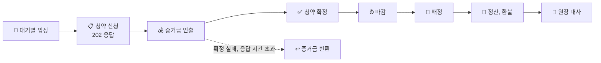
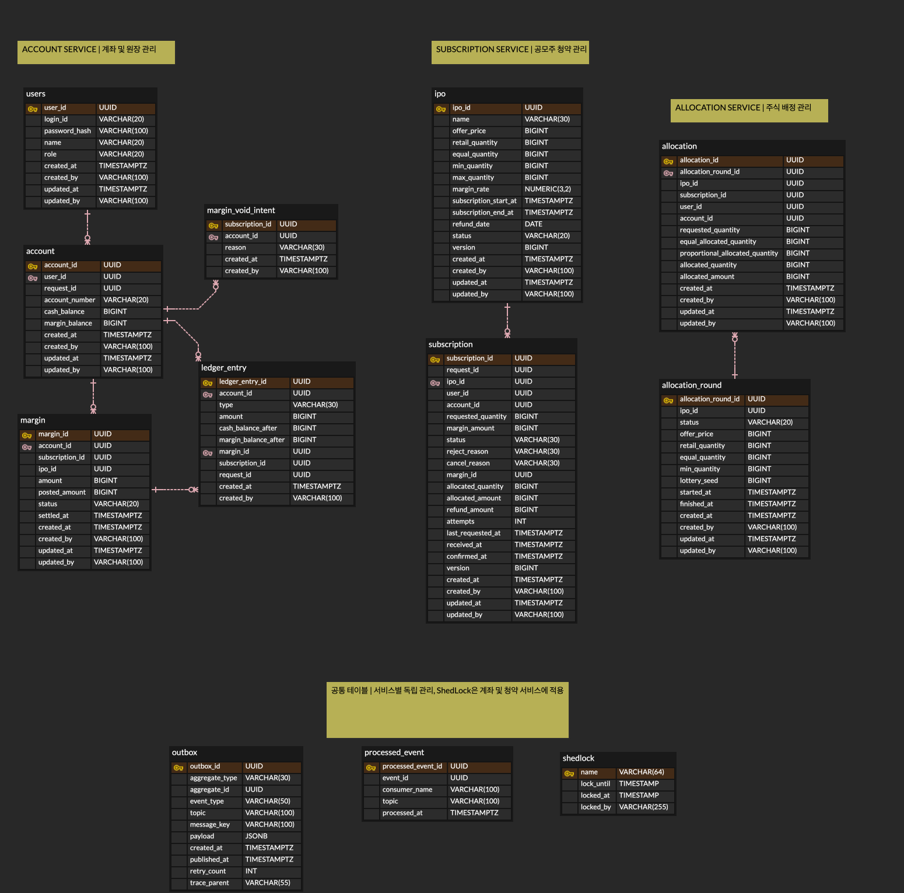
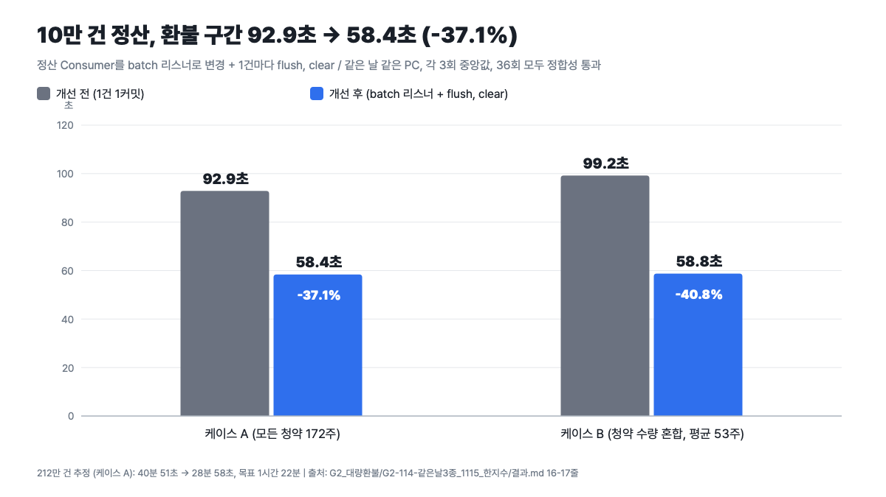
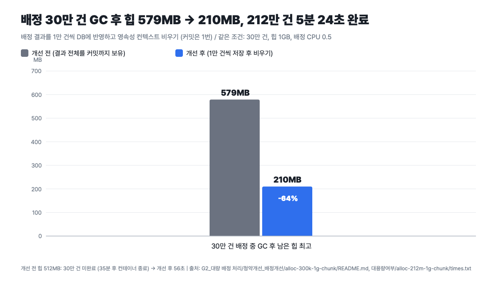

<div align="center">

# 📈 공모주사조

**LG에너지솔루션 청약 규모로 설계한 공모주 청약 MSA**

청약이 집중돼도 접수는 지연 없이, 서비스 일부가 실패해도 증거금과 원장은 1원까지 일치하게

<br>


<br>


</div>

<br>

## 한눈에 보기

2022년 LG에너지솔루션 청약에서 KB증권 한 곳에만 **2,122,367건**이 접수됐습니다. 첫날 일부 증권사 MTS가 일시 먹통이 됐고, 이틀 뒤 110조 원이 환불됐습니다.
공모주사조는 이 규모를 기준으로 피크 트래픽을 계산하고, 측정으로 검증한 공모주 청약 시스템입니다.

<table>
<tr>
<td align="center" width="25%"><h3>433건/초</h3>오류 0%<br><sub>오픈 직후 피크 3회 측정</sub></td>
<td align="center" width="25%"><h3>1.20초</h3>신청 → 확정 p95<br><sub>합격 기준 15초</sub></td>
<td align="center" width="25%"><h3>0건</h3>마감 전 접수 누락<br><sub>마감 직전 274건/초</sub></td>
<td align="center" width="25%"><h3>5분 24초</h3>212만 건 배정<br><sub>실측</sub></td>
</tr>
</table>

| 상황 | 실제로 있었던 일 | 공모주사조의 결과 |
| --- | --- | --- |
| 오픈 직후 접수 집중 | 청약 첫날 일부 증권사 MTS 일시 먹통 | 대기열로 433명/초만 입장, 433건/초 오류 0% |
| 마감 직전 접수 | 마감 시각이 고정이라 직전 신청이 집중 | 274건/초에서 마감 전 접수 누락 0건, 마감 처리 22.4초 |
| 서비스 일부 실패 | 증거금은 인출됐는데 청약 확정 실패 | 계좌 서비스 장애 중에도 증거금 유실, 중복 인출 0건, 복구 후 66초 안에 전액 반환 |
| 대량 배정, 환불 | 청약 이틀 뒤 110조 원 환불 | 212만 건 배정 5분 24초, 정산, 환불 28분 58초 (추정) |

<details>
<summary><b>피크 433건/초, 274건/초는 어떻게 나온 값인가요?</b></summary>

<br>

접수 건수의 20%가 10분(600초)에 집중된다고 가정했습니다.

| 구간 | 계산 | 용도 |
| --- | --- | --- |
| 오픈 직후 | 첫날 1,299,764건 x 20% ÷ 600초 = **433건/초** | 설계 기준 (더 큰 값) |
| 마감 직전 | 마감일 822,603건 x 20% ÷ 600초 = **274건/초** | 마감 누락 검증 (S2) |

</details>

<br>

## 청약 한 건의 흐름



- **청약 서비스**가 SAGA 오케스트레이터로 인출, 확정, 반환을 지시합니다
- **계좌 서비스**는 잔고 변경과 원장 기록을 한 메서드로만 처리합니다
- **배정 서비스**는 마감 이벤트를 받아 균등, 비례, 추첨, 단주 배정을 계산합니다

<br>

## 주요 기능

### 🚪 접속 대기열
처리 한계 아래로 입장을 제한해, 청약 피크에도 접수가 지연되지 않습니다.

- 1초마다 433명에게 입장 허가, 허가 없는 청약 신청은 게이트웨이에서 403
- 순번과 예상 대기 시간 안내, 허가 후 5분 안에 청약
- 게이트웨이 2대에서도 Redis 키로 1초 칸마다 한 대만 입장 처리해 433명/초 유지

### 📋 청약
202 응답 전에 청약과 인출 요청을 한 트랜잭션에 저장해, 마감 전 접수된 요청을 누락하지 않습니다.

- 인출 성공 → 확정 / 예수금 부족 → 거절 / 확정 실패, 응답 시간 초과 → 증거금 반환
- 처리 중 청약 0건을 확인한 후 마감, 실시간 경쟁률 조회

### 💰 계좌, 원장
잔고 변경 메서드가 원장을 생성해 반환하는 구조라, 원장 없이 잔고만 바뀌는 경로가 없습니다.

- requestId와 이벤트 처리 기록으로 중복 요청, 중복 수신을 1회만 반영
- 원장 대사 배치: 10만 계좌 약 1.4초, 주입한 불일치 전부 검출

### 🎯 배정
212만 건 확정 청약을 한 번에 배정하고, 추첨 결과를 재계산으로 증명합니다.

- 균등, 비례, 추첨, 단주 배정 (계산은 한 번에, 저장은 1만 건씩)
- 관리자가 저장된 추첨 시드로 재계산해 청약별 결과 비교 (10만 건 불일치 0건)

### 💸 정산, 환불
배정 대금만 정산하고 나머지는 예수금으로 환불합니다. 장애가 나도 반환이 끝날 때까지 재요청합니다.

- 0주 배정은 증거금 전액 반환, 같은 이벤트를 다시 받아도 1회만 처리
- 반환 응답이 없으면 30초부터 5분 간격까지 늘리며 재요청

### 🔔 운영, 관측
장애는 알림으로 발견하고, 요청 하나를 서비스 간 추적해 원인을 확인합니다.

- Slack 알림 7종: 서비스 종료, 5xx, 커넥션 대기, 힙, 대기열, DLT, ERROR 로그
- 분산 추적(Zipkin), 로그 수집(Loki), CI 통과 커밋만 HTTPS 자동 배포

<br>

## 아키텍처

<details open>
<summary><b>인프라 구성도</b></summary>
<br>

</details>

<details>
<summary><b>시스템 구조도</b></summary>
<br>

</details>

<details>
<summary><b>ERD</b></summary>
<br>

</details>

| 서비스 | 담당 | 나눈 이유 |
| --- | --- | --- |
| subscription-service | 공모주, 청약, SAGA 오케스트레이션 | 접수 피크를 직접 받는 서비스 |
| account-service | 회원, 계좌, 증거금, 원장 | 금전 정합성을 한 곳에서 책임 |
| allocation-service | 배정, 추첨 재현 | 마감 후 대량 계산, 부하 시점이 다름 |
| api-gateway | 인증, 라우팅, 접속 대기열 | 허가 없는 요청을 서비스 이전에 차단 |

서비스마다 스키마와 DB 계정을 분리했고, 다른 서비스 데이터는 Kafka 이벤트로만 주고받습니다. 동기 호출은 배정 → 청약 확정 목록 조회 1곳이며 Timeout과 Circuit Breaker를 적용했습니다.

<br>

## 측정 결과

> 측정 환경: PC 1대에서 서비스, DB, Kafka, k6를 Docker로 실행, 컨테이너 자원 상한 고정, 같은 조건 3회 중앙값

| 목표 | 합격 기준 | 결과 |
| --- | --- | --- |
| G1 접수 성능 | 200건/초 이상, 오류 1% 미만 | **433건/초 오류 0%**, 접수 p95 15.7ms |
| G2 후처리 성능 | 확정 p95 15초 이하, 212만 건 정산, 환불 1시간 22분 | **확정 p95 1.20초**, **28분 58초** (추정) |
| G3 신뢰성 | 재전송, 이중청약, 장애 재현 시 불일치 0건 | 이상 요청 포함 6,000건 위반 0건, 장애 중 7회 불일치 0건 |
| G4 정합성 | 모든 측정 후 검증식 SQL 위반 0건 | 36회 모두 위반 0건 |

- **한계**: 600건/초는 확정 처리 한계(약 510건/초)를 초과해 대기열로 433명/초 제한. 433-600건/초 사이는 측정하지 않음

### 병목 개선 전후

| 지표 | 개선 전 | 개선 후 | 방법 |
| --- | ---: | ---: | --- |
| 433건/초 신청 → 확정 p95 | 54.5초 | **1.4초** | DB CPU 상한, 파티션, Consumer 3 → 6 |
| 확정 처리량 | 345건/초 | **510건/초** | 파티션, Consumer 3 → 6 |
| 마감 처리 시간 | 43.3초 | **22.4초** | 접수 Outbox |
| 10만 건 정산, 환불 구간 | 92.9초 | **58.4초** | batch 리스너 + 건별 flush, clear |
| 배정 처리 규모 | 30만 건 미완료 | **212만 건 5분 24초** | 키셋 조회, 1만 건씩 저장 |
| 배정 결과 커밋 (3만 건) | 11.3초 | **3.0초** | JDBC batch INSERT |
| 경쟁률 조회 중 청약 p95 | 29.0초 | **70ms** | Redis 경쟁률 캐시 |
| 장애 후 반환 대기 청약 | 60-79건 | **0건** | 반환 재요청 백오프 |

<br>

## 트러블슈팅

<details>
<summary><b>1. batch 리스너로 바꿨더니 정산이 19.4% 증가한 이유 → 최종 -37%</b></summary>

<br>


**상황**: 정산 Consumer 처리 시간 비율 91%, DB 세션 idle in transaction 45.1%, WAL 쓰기 대기 27.6%. 1건 1커밋이 원인이라고 보고 batch 리스너(100건 1트랜잭션)로 변경

**문제**: 재측정에서 정산 구간이 93.6 → 111.8초로 오히려 증가

**원인**: JFR CPU 샘플의 77.4%가 Hibernate flush (개선 전 15.0%). 쿼리마다 실행되는 자동 flush가 배치 안에 누적된 엔티티 전체를 변경 감지. batch size 500으로 키우면 315.8초로 증가해, 비용이 건수 제곱에 비례함을 확인

**해결**: 1건 처리 후 flush, clear (트랜잭션과 커밋은 배치당 1번 유지)

**결과**: 10만 건 정산, 환불 구간 92.9 → 58.4초, 212만 건 추정 40분 51초 → 28분 58초, 36회 모두 정합성 위반 0건

</details>

<details>
<summary><b>2. CPU를 2배로 올려도 그대로였던 확정 지연 54.5초 → 1.4초</b></summary>

<br>


**상황**: 433건/초에서 신청 → 확정 p95 54.5초 (기준 15초)

**원인 추적**: 청약 서비스 CPU 상한을 2배로 올려도 54.47 → 54.63초. 요청이 끝난 후 남은 메시지만 처리하는 구간에서도 CPU는 여유가 있는데 처리 속도가 같음 → 동시 처리 수(파티션 3, Consumer 3)가 원인

**해결**: 한 번에 한 가지만 변경하고 측정. PostgreSQL CPU 상한 1 → 2 (확정 280 → 345건/초), 파티션과 Consumer를 3 → 6으로 함께 변경

**결과**: 확정 p95 1.4초, 확정 처리량 +48%. 600건/초는 여전히 불합격이라 대기열 입장 속도를 433명/초로 결정

</details>

<details>
<summary><b>3. 끝나지 않던 30만 건 배정 → 212만 건 5분 24초</b></summary>

<br>


**원인**: 30만 건은 메모리 (결과 1건 약 1.8KB를 커밋까지 보유), 50만 건은 offset 조회 지연 (페이지 최대 12초)으로 Kafka 처리 한도 5분 초과

**검토한 선택지**

| 선택지 | 제외 이유 |
| --- | --- |
| 힙만 증설 | 212만 건에 약 3.8GB 필요 |
| 1만 건마다 커밋 | 중간 실패 시 결과 일부만 발행 |
| 계산까지 분할 | 추첨 결과가 달라져 추첨 재현 불가 |

**해결**: 계산은 한 번에, 저장만 1만 건씩 DB 반영 후 비우기, 커밋은 1번. 확정 청약 조회를 키셋 방식으로 변경

**결과**: 212만 건 5분 24초, 중간 실패 시 전체 롤백, 추첨 재현 결과 동일

</details>

<details>
<summary><b>4. 실시간 경쟁률 하나가 청약 접수까지 지연시킨 문제</b></summary>

<br>

**상황**: 경쟁률을 DB 합산으로 구현한 후, 청약과 목록 조회를 동시에 거는 시나리오(S7)를 추가해 측정

**원인**: 합산 쿼리 평균 421ms, PostgreSQL CPU 상한 도달, 청약 서비스 커넥션 30개 모두 사용 중 (대기 최대 175). 조회 기능 하나가 같은 DB를 사용하는 청약 접수까지 지연시킴

**해결**: 경쟁률을 Redis 캐시에서 조회 (기준은 DB, 캐시가 비면 DB로 다시 계산). Redis 장애 시에도 접수는 그대로 동작하고 경쟁률만 DB로 계산

**결과**: 청약 p95 29.0초 → 70ms, 목록 조회 p95 29.5초 → 62ms, 지연된 요청 64,719건 → 0건

</details>

<details>
<summary><b>5. 장애가 8분 지속되면 증거금 반환이 영구 정체되던 문제</b></summary>

<br>

**상황**: 부하 중 계좌 서비스의 반환 처리만 약 8분 실패시키는 장애 주입

**원인**: 반환 재요청 3회가 장애 시간 안에 모두 실패해 이후 재요청 없음. 청약은 COMPENSATING, 증거금은 PENDING으로 남음

**해결**: 30 → 60 → 120 → 240초 → 5분 간격으로 응답이 올 때까지 재요청, 5회 이상이면 반환 지연 알림

**결과**: 반환 대기 청약 60-79건 → 0건, PENDING 증거금 60만-79만 원 → 0원, 장애 해제 후 64-66초 안에 전부 반환

</details>

<details>
<summary><b>6. Redis 메모리 상한에서 대기자가 허가 없이 소멸하던 문제</b></summary>

<br>

**원인**: Lua 스크립트가 대기열에서 꺼내기(ZPOPMIN) → 허가 저장(SET) 순서. 메모리 상한에서 SET만 거부되고 이전 명령은 롤백되지 않음

**해결**: 허가 저장(SET) → 대기열에서 제거(ZREM) 순서로 변경, 실패하면 대기자는 대기열에 그대로 유지

**결과**: 허가 없이 소멸하는 대기자 0명, 상한 해제 후 순번 그대로 입장 재개. 원래 순서로 되돌리면 테스트가 실패하는 것도 확인

</details>

<br>

## 기술적 의사결정

설계 결정은 선택지, 선택 이유, 감수한 점, 재검토 조건을 결정기록 33건으로 남겼습니다. 그중 핵심 7가지입니다.

<details>
<summary><b>접수 경로: Kafka 직접 적재 → DB 저장 + Outbox 후 202</b></summary>

<br>

- **문제**: 202를 받은 청약이 Consumer 처리 전이면 DB에 없어, 마감 직전 접수가 배정에서 누락될 수 있음
- **선택**: 청약과 인출 요청을 한 트랜잭션에 저장한 후 202
- **결과**: 마감 전 접수 누락 0건, 마감 처리 43.3 → 22.4초
- **트레이드오프**: 600건/초에서 응답 p95 41-50 → 60-240ms 증가 (WAL 쓰기 대기), 마감 보장을 위해 수용

</details>

<details>
<summary><b>SAGA Orchestration</b></summary>

<br>

- **문제**: 청약과 계좌가 다른 서비스라 한 트랜잭션으로 처리 불가
- **선택**: 청약 서비스가 인출, 확정, 반환을 지시
- **이유**: 청약 상태가 청약 서비스에 있어 보상 시작점이 한 곳이고 상태 추적이 쉬움

</details>

<details>
<summary><b>대기열 입장 속도 433명/초</b></summary>

<br>

- **문제**: 90초 단계 부하에서 600건/초까지 성공. 입장 속도를 600으로 결정해도 되는가
- **분석**: 600건/초에서 확정 약 522건/초, 대기가 초당 78건 증가 → 약 100초 지속 시 확정 기준 15초 초과
- **선택**: "한 번 성공한 값"이 아니라 "계속 받아도 지연되지 않는 값"인 433명/초

</details>

<details>
<summary><b>대량 배정: 1만 건마다 커밋하지 않고 한 트랜잭션 유지</b></summary>

<br>

- **문제**: 212만 건 결과를 커밋까지 메모리에 보유하면 힙 부족
- **선택**: 계산은 한 번에, 저장만 1만 건씩 DB 반영 후 비우기, 커밋은 1번
- **결과**: 212만 건 5분 24초, 중간 실패 시 전체 롤백

</details>

<details>
<summary><b>증거금 반환 재요청: 횟수 제한 → 응답이 올 때까지 백오프</b></summary>

<br>

- **문제**: 재요청 3회가 장애 시간 안에 모두 실패하면 증거금이 PENDING으로 영구히 남음
- **선택**: 5분 상한까지 간격을 늘리며 계속 재요청, 5회 이상이면 반환 지연 알림
- **이유**: 반환은 결국 성공해야 하는 작업이라, 포기 대신 알림으로 사람에게 전달

</details>

<details>
<summary><b>증거금률 100%, 계좌 내 인출</b></summary>

<br>

- **문제**: 실제 청약은 증거금률 50%라 배정 대금이 증거금보다 크면 추가 납입 발생
- **선택**: 증거금률 100%, 예수금 → 청약증거금 인출
- **이유**: 추가 납입 흐름 없이 정산, 환불과 원장 정합성에 집중

</details>

<details>
<summary><b>수평 확장: 인스턴스 2개에서 발생하는 중복 실행</b></summary>

<br>

- **문제**: 서비스, 게이트웨이를 2개씩 실행하면 스케줄러, Outbox 발행기, 대기열 입장이 인스턴스마다 실행됨 (중복 발행, 입장 속도 866명/초)
- **선택**
  - 스케줄러: ShedLock으로 한 인스턴스만 실행 (1분간 마감 대상 조회 24 → 12회)
  - Outbox 발행기: ShedLock + 1회 실행 30초 상한, 락 유지 시간 1분 안에 종료
  - 대기열 입장: Redis 키로 1초 칸마다 한 게이트웨이만 입장 처리
- **이유**: 락만 적용하면 212만 건 대량 발행 중 락이 만료돼 중복이 다시 발생. SKIP LOCKED는 같은 키의 전송 순서가 역전돼 제외
- **트레이드오프**: 발행은 인스턴스를 늘려도 1개만 실행해 처리량 확장 없음

</details>

<br>

## 기술 스택

| 분류 | 기술 |
| --- | --- |
| Backend | Java 21, Spring Boot 3.5.16, Spring Cloud Gateway, Eureka, OpenFeign, Resilience4j, JWT, ShedLock |
| Messaging | Apache Kafka 4.3.1, Kafka UI |
| Database | PostgreSQL 16, Redis 7 |
| Test | k6, JUnit5, Testcontainers, Synthetic Data (LLM) |
| Infra | AWS EC2, Docker Compose, Amazon ECR, GitHub Actions, AWS SSM, Caddy (HTTPS) |
| Monitoring | Prometheus, Grafana, Zipkin, Loki, Slack Alert |

| 기술 | 선택 이유 | 결과 |
| --- | --- | --- |
| **Kafka** | SAGA 이벤트 전달, 파티션 키(회원, 계좌, 공모주)로 같은 키 순서 보장, 재시도 3회 후 DLT | 파티션, Consumer 3 → 6으로 확정 처리 345 → 510건/초 |
| **PostgreSQL** | 잔고 변경, 원장 기록, Outbox를 한 트랜잭션에 저장, 조건부 유니크 인덱스로 이중청약 차단 | 모든 측정에서 검증식 위반 0건 |
| **Redis** | 대기열 순번(Sorted Set)과 입장 허가(TTL 5분)는 화면용 임시 상태라 DB와 분리 | Redis 장애 시 허가 없이 통과시키지 않고 503 |
| **Resilience4j** | 유일한 동기 호출(배정 → 청약 확정 목록)에 Timeout, Circuit Breaker | 청약 서비스 장애가 배정 서비스로 전파되지 않음 |
| **Zipkin, Loki** | 요청 하나가 게이트웨이, 청약, Kafka, 계좌를 경유 | 추적 ID로 서비스 간 흐름과 로그를 한 번에 조회 |

<br>

## AI와 협업한 방식

팀원 5명이 각자 Claude Code로 개발하면 세션마다 용어, 구조, 이벤트 계약이 달라질 수 있어, 팀 공용 [`CLAUDE.md`](CLAUDE.md)와 기준 문서를 저장소에 두고 5명 모두에게 같은 규칙을 적용했습니다.

| 팀 규칙 | 바뀐 결과 |
| --- | --- |
| 용어와 코드명은 [유비쿼터스 언어](docs/UBIQUITOUS_LANGUAGE.md) 그대로 | "홀드, 확보" → "증거금 인출", `investorId` → `userId`로 통일 |
| 문서에 없는 필드, 상태값, 이벤트 계약은 임의 결정 금지 | 구현 전에 먼저 질문, 팀 결정 후 문서부터 수정 |
| 삭제 금지, 원장은 추가만 | 서비스 3개 코드에 삭제 호출 0건 |
| 잔고 변경과 원장 기록은 정해진 메서드 하나로만 | 원장 없이 잔고만 변경 가능한 코드 경로 6곳 → 0곳 |

AI 제안 9건 중 수용 3건, 번복 2건, 거부 4건. 모든 제안은 테스트(검사 줄을 제거하면 실패하는지 확인)와 같은 조건 재측정으로 확인한 후 채택했습니다.

<br>

## 실행하기

```bash
git clone https://github.com/gongmoju-4jo/ipo-subscription.git
cd ipo-subscription
cp .env.example .env                                 # DB 비밀번호, JWT_SECRET 입력
./gradlew build -x test && docker-compose up -d --build
```

| 화면 | 주소 |
| --- | --- |
| 통합 Swagger | http://localhost:8080/swagger-ui/index.html |
| Eureka | http://localhost:8761 |
| Grafana | http://localhost:3000 |
| Kafka UI | http://localhost:8989 |
| Zipkin | http://localhost:9411 |

- 프론트 화면은 [frontend/README](frontend/README.md), 부하 테스트는 [부하 테스트 가이드](docs/LOADTEST.md) 참고
- Docker 메모리 6GB 이상 권장

<br>

## 문서

| 문서 | 내용 |
| --- | --- |
| [프로젝트 세팅 가이드](docs/PROJECT_SETUP.md) | 실행 방법, 구조, common 모듈, 엔티티, 예외, Swagger 규칙 |
| [부하 테스트 가이드](docs/LOADTEST.md) | 부하 테스트 환경 준비와 실행 절차, 시나리오, 결과 파일 |
| [유비쿼터스 언어](docs/UBIQUITOUS_LANGUAGE.md) | 도메인 용어, 코드명, 상태값 |
| [GitHub 협업 가이드](docs/GITHUB_GUIDE.md) | 이슈, 브랜치, 커밋, PR 규칙 |

<br>

## 팀원

| | 담당 | 주요 기여 |
| --- | --- | --- |
| **한지수** (팀장)<br>[@eldeoddt](https://github.com/eldeoddt) | 💰 계좌 (증거금, 원장) | 증거금 인출, 반환, 정산, 환불과 원장 기록<br>정합성 검증식 SQL 자동화, 원장 대사 배치<br>정산 batch 리스너 원인 분석 (92.9 → 58.4초) |
| **김진우**<br>[@Kimjinwoo99](https://github.com/Kimjinwoo99) | 🚪 회원, 인프라, 대기열 | JWT 인증, Redis 접속 대기열, 모니터링, HTTPS 자동 배포<br>파티션, Consumer 3 → 6 (확정 p95 54.5 → 1.4초)<br>게이트웨이 여러 대에서 입장 속도 유지 |
| **이승훈**<br>[@tcrnela](https://github.com/tcrnela) | 🎯 배정 | 균등, 비례, 추첨, 단주 배정, 추첨 재현<br>대량 배정 (30만 건 미완료 → 212만 건 5분 24초)<br>JDBC batch INSERT (11.3 → 3.0초), ShedLock 공통 기반 |
| **이창열**<br>[@askl690](https://github.com/askl690) | 📋 청약 접수 | 공모주, 청약 접수 API, 마감 스케줄러<br>접수 Outbox (마감 처리 43.3 → 22.4초, 누락 0건)<br>Redis 경쟁률 캐시 (청약 p95 29.0초 → 70ms) |
| **최승근**<br>[@choiseungkeun](https://github.com/choiseungkeun) | 📋 청약 SAGA | SAGA 오케스트레이터, 보상 트랜잭션, DLT<br>반환 재요청 백오프 (반환 대기 60-79건 → 0건)<br>증거금 인출 batch 처리 |
