# 

> 공모주 청약, 해보셨나요?  
> 청약이 시작되면 수많은 신청이 동시에 접수돼요.  
> 공모주사조는 이런 상황에서도 청약을 안정적으로 접수하고, 증거금과 원장의 정합성을 지키도록 설계했어요.  
> 2022년 LG에너지솔루션 청약 규모(KB증권 212만 건)를 기준으로 직접 검증했어요. 📈
> <br><br>🏆 최종 프로젝트 대상

<br>

## Overview

<p align="center"></p>

- **오픈 직후 (가정)**: 초당 433건의 청약 부하에서 오류 0%, 신청부터 확정까지 p95 0.96초
- **마감 직전 (가정)**: 초당 274건의 청약 부하에서 배정 대상 누락 0건
- **대량 배정**: 212만 건을 5분 24초 만에 배정 완료 (1회 실측)
- **금전 정합성**: 대량 정산 36회 측정에서 정합성 위반 0건

<br>

## Main Features

### 1. 접속 대기열
- 청약이 집중되면 1초마다 433명씩 입장을 허가하고, 내 앞 대기 인원과 예상 대기 시간을 안내합니다.
- 입장 허가가 없는 청약 신청은 게이트웨이가 403으로 차단합니다.

<p align="center"> <br><sub>왼쪽 대기 화면 (내 앞 대기 인원, 예상 대기 시간), 오른쪽 청약 화면 (청약 가능 시간 5분, 예상 청약증거금)</sub></p>

### 2. 청약과 SAGA 보상
- 청약을 DB에 저장하면 바로 202로 응답합니다. 증거금 인출과 확정은 이후 Kafka 이벤트로 처리합니다.  
  예수금이 부족하면 거절하고, 확정에 실패하면 증거금을 반환합니다.
- 계좌 서비스 장애 주입 테스트에서 증거금 유실과 중복 인출은 0건이었습니다.

<p align="center"> <br><sub>왼쪽 홈 (예수금, 청약증거금, 진행 중인 청약), 오른쪽 계좌 (입금 → 증거금 인출 → 배정 대금 정산 → 환불)</sub></p>

### 3. 배정, 정산, 환불
- 마감 후 균등, 비례, 추첨, 단주 순서로 배정하고, 배정 대금만 정산한 후 남은 증거금은 예수금으로 환불합니다.
- 추첨 시드를 기록해 관리자가 같은 결과를 다시 계산해 확인합니다 (10만 건 불일치 0건).

<p align="center"><br><sub>배정 결과: 균등 11주 + 비례 8주, 배정 대금 정산 후 남은 증거금 환불</sub></p>

### 4. 원장 정합성
- **방지**: 예수금, 청약증거금을 변경하는 거래는 모두 원장에 기록합니다. 잔고 변경과 원장 저장은 같은 트랜잭션에서 처리합니다.  
  같은 요청(requestId)이나 같은 이벤트(eventId)가 다시 수신되면 한 번만 반영합니다 (이벤트 처리 기록 `processed_event`).
- **검증**: 측정이 끝날 때마다 정합성 검증 SQL을 실행했습니다 (기본 22개, 장애 주입 시험 26개). 대량 정산 36회 측정에서 위반은 0건이었습니다.
- **감지**: 매일 04:00 원장 대사 배치가 잔고, 증거금, 원장의 불일치를 검사해 ERROR 로그와 Slack으로 알립니다. 불일치 데이터를 자동으로 수정하지는 않습니다.

<p align="center">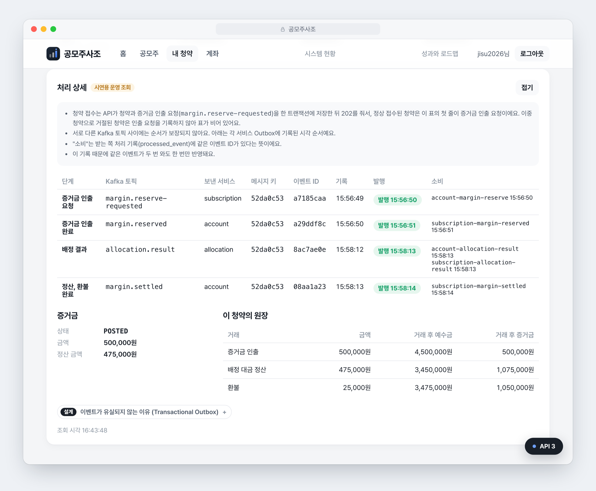<br><sub>청약 1건의 Kafka 이벤트 4개와 원장 3줄 (시연용 운영 조회 화면, 배포 미포함)</sub></p>

### 5. 운영과 관측
- 서비스 종료, 5xx, DLT 적재 등 7가지 장애를 Slack으로 알리고, Zipkin과 Loki로 요청 흐름과 로그를 추적합니다.
- CI가 성공한 커밋만 EC2에 HTTPS로 자동 배포합니다.

<p align="center"> <br><sub>왼쪽 Grafana 측정 대시보드 (처리량, 응답 시간, 커넥션, CPU, 힙, GC), 오른쪽 Zipkin 분산 추적 (마감 → 배정 → 청약 결과 수신)</sub></p>

<details>
<summary>Grafana 알림 규칙 7종</summary>
<br>

<p align="center">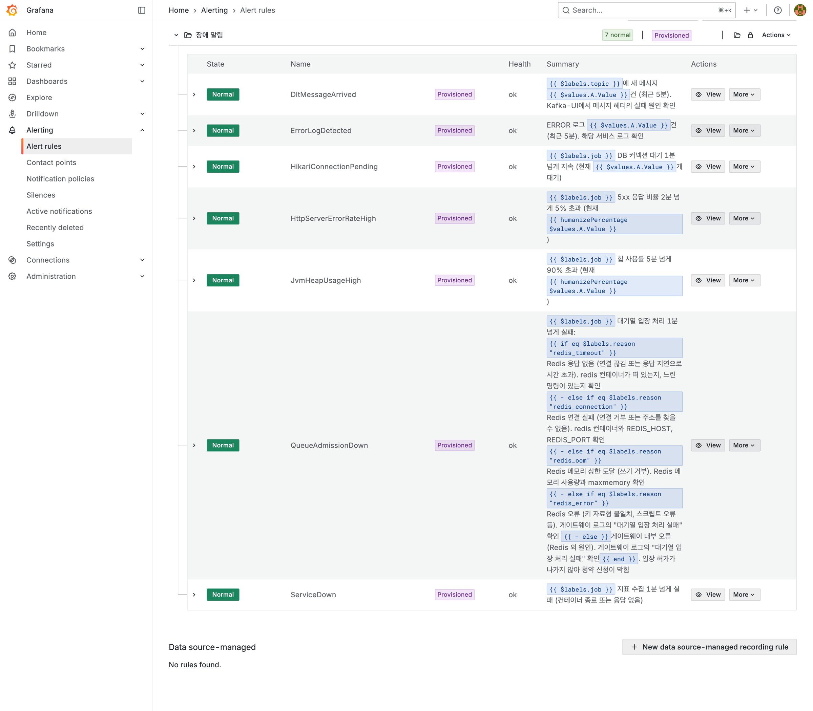</p>

</details>

<br>

## Architecture

### 서비스와 처리 흐름


<details>
<summary>상세 시스템 구조도</summary>


</details>

- **api-gateway**: 외부 요청의 입구. JWT 검증, 접속 대기열, 라우팅
- **subscription-service**: 공모주, 청약 관리. SAGA 오케스트레이터로 증거금 인출, 확정, 반환을 요청
- **account-service**: 회원, 계좌, 증거금, 원장 관리. 잔고 변경과 원장 기록은 이 서비스에서만 처리
- **allocation-service**: 마감된 공모주의 배정 계산, 추첨 재현

**청약 한 건이 처리되는 순서**

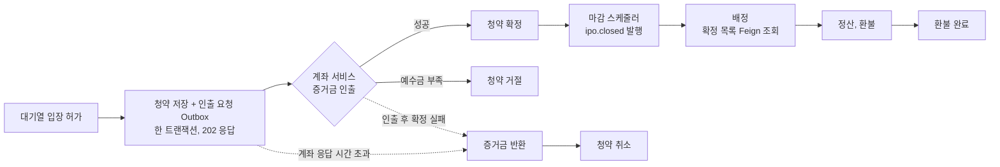

청약 접수 과정에서 계좌 서비스의 응답을 기다리지 않도록 Kafka 기반의 비동기 처리를 적용했습니다.

청약과 증거금 인출 요청을 같은 트랜잭션에 저장한 뒤 202로 응답합니다. 이후 Outbox 발행기가 인출 요청을 Kafka로 발행합니다 (Transactional Outbox).

청약 접수 경로에는 서비스 간 동기 호출을 두지 않았습니다. 동기 호출이 필요한 두 곳도 청약 요청과 분리했습니다.
- **배정 → 청약**: 마감 후 확정된 청약 목록을 조회합니다. Timeout과 Circuit Breaker를 적용해 호출 지연과 장애에 대응합니다.
- **게이트웨이 → 청약**: 대기열 진입 확인에 필요한 공모주 목록을 5초마다 갱신하고 메모리에 저장해, 사용자 요청마다 청약 서비스를 호출하지 않습니다.

- 실패 처리 (발행 누락, 중복 수신, DLT, SAGA 보상, 동기 호출 장애): [청약 SAGA 실패 시나리오](docs/scenario/saga-failure.md), [장애 대응 절차](docs/scenario/incident-response.md)

### 인프라 구성

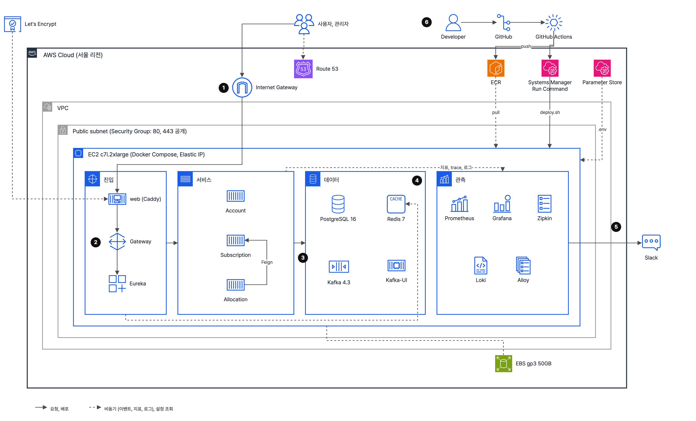

- **진입**: Route 53 → Caddy(HTTPS, Let's Encrypt 자동 갱신) → Gateway. 외부에는 80, 443만 공개
- **데이터**: PostgreSQL 1개에 서비스별 스키마와 전용 계정 분리, Kafka KRaft 단일 브로커 (파티션 6개)
- **배포**: CI가 성공한 커밋만 ECR에 올리고 SSM Run Command로 배포. SSH 포트는 열지 않음

<details>
<summary>자원 할당, 한계</summary>
<br>

**서비스별 자원 할당** (`compose.perf.yml`)
- 청약, PostgreSQL 각 2.0코어 / 1GiB
- 계좌, 게이트웨이, Kafka 각 1.0코어 / 1GiB
- 배정 0.5코어 / 2GiB (힙 1.5GiB), web 0.5코어 / 256MiB
- 나머지 0.25-0.5코어, 상한 합계 CPU 11.25코어 (EC2 8 vCPU)

**한계**
- EC2 1대라 단일 장애점 (ALB, Auto Scaling 없음)
- Kafka 단일 브로커, 복제본 없음
- PostgreSQL도 같은 EC2의 컨테이너 (RDS 없음)
- 원장 저장 누락을 코드 구조로 차단하지 않음  
  누락은 원장 대사 배치가 다음 실행 때 감지하고, 자동 복구는 하지 않음

</details>

<details>
<summary>상세 인프라 구성도 (포트, 역할, 배포 검증 포함)</summary>

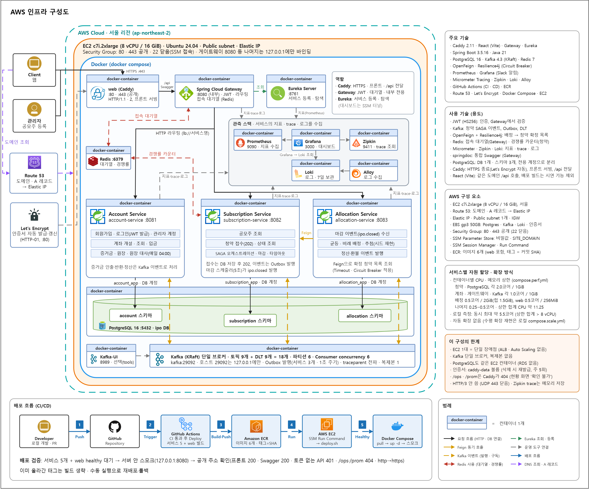

</details>

<br>

## Performance

같은 조건에서 개선 전후를 비교한 결과입니다.

| 지표 | 전 | 후 | 개선율 | 변경 내용 |
| --- | ---: | ---: | ---: | --- |
| 433건/초 신청 → 확정 p95 | 54.5초 | **1.4초** | 97.4% 단축 | PostgreSQL CPU 1 → 2, 파티션, Consumer 3 → 6 (누적) |
| 600건/초 신청 → 확정 p95 | 29.43초 | **0.98초** | 96.7% 단축 | 인출 batch 리스너 + 접수 SQL 6 → 4 |
| 433건/초 접수 응답 p95 | 40.1ms | **10.8ms** | 73.1% 단축 | 인출 batch 리스너 + 접수 SQL 6 → 4 |
| 10만 건 정산, 환불 구간 | 92.9초 | **58.4초** | 37.1% 단축 | batch 리스너 + 건별 flush, clear |
| 경쟁률 조회 중 청약 p95 | 29.0초 | **70ms** | 99.8% 단축 | Redis 경쟁률 캐시 |
| 배정 처리 규모 | 30만 건 미완료 | **212만 건 5분 24초** (1회 실측) | - | 키셋 조회, 1만 건씩 저장 |
| 장애 후 반환 대기 청약 | 60-79건 | **0건** | - | 반환 재요청 백오프 |

**측정 조건**
- 환경: 팀원 PC에서 서비스, DB, Kafka, k6를 모두 Docker로 실행  
  컨테이너 자원 상한(`compose.perf.yml`) 고정, 배포 환경(EC2)에서 측정한 값이 아님
- 비교: 개선 전후는 같은 PC, 같은 조건에서 3회 측정한 중앙값
- 피크 부하: 접수의 20%가 10분에 집중된다고 가정  
  오픈 직후 433건/초 (첫날 1,299,764건), 마감 직전 274건/초 (마감일 822,603건)

**참고**
- 최신 코드(인출 batch 리스너 + 접수 SQL 6 → 4)의 433건/초 신청 → 확정 p95는 0.96초입니다.
- 입장 속도 433명/초는 확정 처리 한계(약 510건/초)를 넘지 않게 결정한 값입니다. 600건/초 초과는 측정하지 않았습니다.

<br>

## Troubleshooting

<details open>
<summary><b>정산을 개선하려고 batch로 바꿨는데, 처리 시간이 오히려 19.4% 증가했다</b><br><sub>10만 건 정산 92.9초 → 58.4초 (37.1% 단축)</sub></summary>
<br>

**관련 서비스**: account-service  
**담당**: [한지수](https://github.com/eldeoddt)  
**PR**: [#160](https://github.com/gongmoju-4jo/ipo-subscription/pull/160)


- **문제**: 정산 Consumer가 1건마다 커밋해 WAL 쓰기 대기 비율이 27.6%였음
- **시도**: 100건을 한 트랜잭션으로 처리하는 batch 리스너로 변경  
  그런데 10만 건 정산 구간이 93.6초에서 111.8초로 오히려 증가함
- **원인**: JFR로 CPU를 샘플링하니 77.4%가 Hibernate flush였음
  - 쿼리마다 실행되는 자동 flush가 배치에 누적된 엔티티 전체를 매번 변경 감지
  - batch size가 커질수록 영속성 컨텍스트에 누적된 엔티티를 반복적으로 변경 감지해 비용이 증가함. batch size를 500으로 증가시켰을 때 정산 시간이 315.8초까지 증가함
- **해결**: 1건 처리할 때마다 flush, clear하고, 커밋은 배치당 1번 유지
- **결과**: 10만 건 정산 구간 92.9초 → 58.4초 (37.1% 단축)
  - 212만 건 마감부터 마지막 정산까지 추정 40분 51초 → 28분 58초 (실측 처리량 기반)

</details>

<details>
<summary><b>CPU를 2배로 증설했는데, 청약 확정 시간은 그대로였다</b><br><sub>433건/초 신청 → 확정 p95 54.5초 → 1.4초</sub></summary>
<br>

**관련 서비스**: subscription-service, account-service, PostgreSQL, Kafka  
**담당**: [김진우](https://github.com/Kimjinwoo99)  
**PR**: [#86](https://github.com/gongmoju-4jo/ipo-subscription/pull/86)


- **문제**: 초당 433건 부하에서 신청부터 확정까지 걸린 시간(p95)이 54.5초
- **확인**: 청약 서비스 CPU 상한을 2배로 증설해도 54.6초로 그대로였음
- **원인**
  - PostgreSQL CPU: 사용량이 상한 1코어에 도달
  - 동시 처리 수: 파티션 3, Consumer 3이라 동시에 3건만 처리
- **해결**: 한 번에 하나씩 변경하며 측정
  - PostgreSQL CPU 상한 1 → 2: 54.6초 → 36.1초, 확정 처리량 280 → 345건/초
  - 파티션, Consumer 3 → 6: 36.1초 → 1.4초, 확정 처리량 345 → 510건/초 (+48%)
- **결과**: 신청부터 확정까지 p95 54.5초 → 1.4초

</details>

<details>
<summary><b>433건/초는 기준을 충족했는데, 600건/초에서는 확정이 29초까지 증가했다</b><br><sub>신청 → 확정 p95 29.43초 → 0.98초</sub></summary>
<br>

**관련 서비스**: subscription-service, account-service  
**담당**: [이창열](https://github.com/askl690), [최승근](https://github.com/choiseungkeun)  
**PR**: [#179](https://github.com/gongmoju-4jo/ipo-subscription/pull/179), [#161](https://github.com/gongmoju-4jo/ipo-subscription/pull/161)

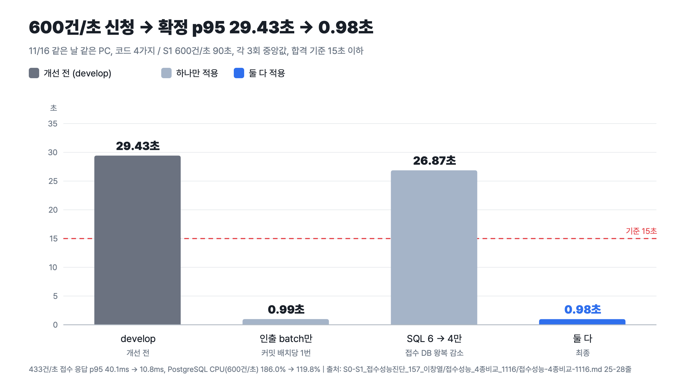

- **문제**: 접수 Outbox 적용 후에도 600건/초에서 신청부터 확정까지 p95가 29.43초 (기준 15초)
  - 접수 Outbox: 202를 받은 청약이 마감 집계에서 누락되지 않게, 청약과 Outbox를 한 트랜잭션에 저장한 후 응답
- **원인**
  - 확정 지연: PostgreSQL 대기 중 WAL 쓰기 대기가 61-69%로, 커밋 횟수가 병목. 계좌 서비스 인출 Consumer가 메시지마다 커밋
  - 접수 응답: 청약 접수 1건에 SQL 6개를 한 트랜잭션 안에서 왕복
- **해결**
  - 인출 batch 리스너: 커밋을 배치당 1번으로 감소
  - 접수 DB 왕복 감소: SQL 6개 → 4개
- **결과**: 600건/초 신청 → 확정 p95 29.43초 → 0.98초, 433건/초 접수 응답 p95 40.1ms → 10.8ms
  - 확정 지연은 인출 batch만 적용해도 0.99초로 해소, SQL 감소만으로는 26.87초
  - 600건/초 PostgreSQL CPU 186.0% → 119.8% (1코어 = 100%)

</details>

<details>
<summary><b>30만 건에서 멈추던 배정, 212만 건까지</b><br><sub>30만 건 미완료 → 212만 건 5분 24초 (1회 실측)</sub></summary>
<br>

**관련 서비스**: allocation-service, subscription-service  
**담당**: [이승훈](https://github.com/tcrnela), [이창열](https://github.com/askl690)  
**PR**: [#146](https://github.com/gongmoju-4jo/ipo-subscription/pull/146), [#139](https://github.com/gongmoju-4jo/ipo-subscription/pull/139)


- **문제**
  - 30만 건: 배정 결과(1건 약 1.8KB)를 커밋할 때까지 메모리에 들고 있어 힙 부족
  - 50만 건: offset 조회가 페이지당 최대 12초까지 지연돼 Kafka 처리 한도 5분 초과
- **검토한 대안**
  - 힙만 증설: 212만 건에 약 3.8GB 필요
  - 1만 건마다 커밋: 중간 실패 시 결과 일부만 발행
  - 계산까지 분할: 기존 추첨 알고리즘에서는 분할 방식에 따라 결과가 달라질 수 있어 동일한 추첨 결과를 재현하기 어려움
- **해결**: 계산은 한 번에 하고, 저장만 1만 건씩 DB에 반영한 후 메모리에서 비움  
  커밋은 1번으로 유지하고, 조회는 키셋 방식으로 변경
- **결과**: 212만 건 5분 24초, 중간 실패 시 전체 롤백, 추첨 재현 결과 동일

</details>

<details>
<summary><b>장애는 복구됐는데, 증거금은 반환되지 않았다</b><br><sub>반환 대기 60-79건 → 0건</sub></summary>
<br>

**관련 서비스**: subscription-service, account-service  
**담당**: [최승근](https://github.com/choiseungkeun)  
**PR**: [#148](https://github.com/gongmoju-4jo/ipo-subscription/pull/148), [#143](https://github.com/gongmoju-4jo/ipo-subscription/pull/143)

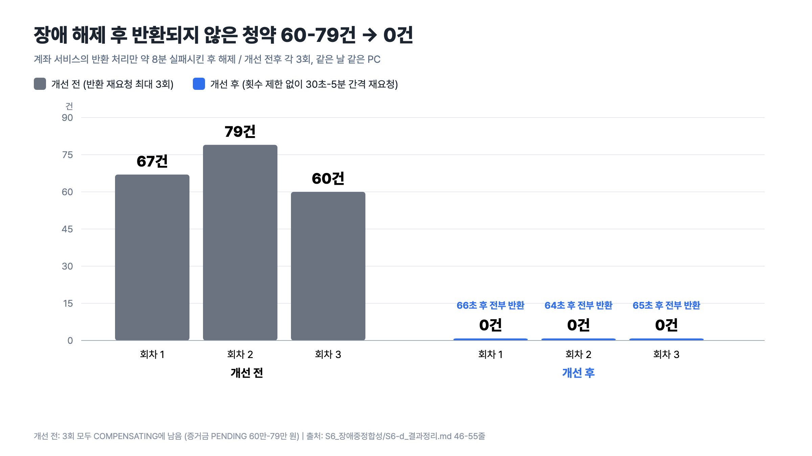

- **문제**: 계좌 서비스의 반환 처리만 약 8분 실패시키자, 청약은 COMPENSATING, 증거금은 PENDING으로 남았음
- **원인**: 반환 재요청 3회가 장애 시간 안에 모두 실패
- **요구사항**: 보상이 시작된 청약은 증거금 반환까지 완료돼야 함
- **해결**: 재요청 횟수 제한을 없애고 응답이 올 때까지 재요청  
  간격은 30초에서 5분까지 증가시키고, 5회 이상 실패하면 반환 지연 알림 발송
- **결과**: 반환 처리 8분 장애 주입 시 COMPENSATING 잔류 60-79건 → 0건
  - 장애 해제 후 64-66초 안에 전부 반환
- **한계**: 반환이 계속 실패하면 청약은 COMPENSATING에 남고, 반환 지연 알림으로 확인

</details>

<details>
<summary><b>잔고와 원장이 불일치하면, 어떻게 알아낼까?</b><br><sub>주입한 불일치 7건 모두 감지</sub></summary>
<br>

**관련 서비스**: account-service  
**담당**: [한지수](https://github.com/eldeoddt)  
**PR**: [#154](https://github.com/gongmoju-4jo/ipo-subscription/pull/154), [#134](https://github.com/gongmoju-4jo/ipo-subscription/pull/134)

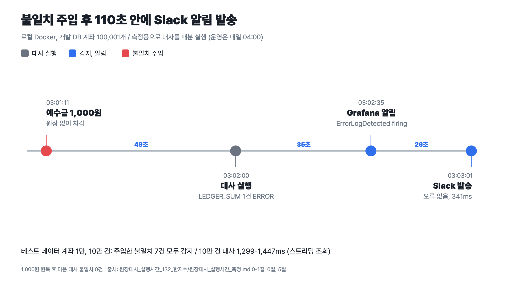

- **문제**: 정합성 검사(`loadtest/sql/verify.sql`)는 부하 측정 때만 실행돼, 운영 중 불일치를 감지할 방법이 없었음
- **해결**: 매일 04:00 원장 대사 배치 실행
  - 계좌 잔고, 증거금, 원장을 검사 5개로 대조하고, 조회만 하며 수정하지 않음
  - 불일치는 ERROR 로그로 기록해 Slack 장애 알림 발송
  - 불일치 행은 스트리밍 조회로 검사당 100건만 보관 (212만 건 규모에서 힙 초과 방지)
- **결과**: 주입한 불일치 7건 모두 감지, 계좌 10만 건 대사 1,299-1,447ms
- **AI 수정 검증**: 정상 취소 청약을 위반으로 집계하던 검사 SQL을 AI가 수정하면서, 금액 비교까지 제외해 실제 위반을 감지하지 못함
  - 리뷰에서 발견해 증거금 ID 비교에서만 제외하고 금액 비교는 유지, 실제 위반 4건 모두 검출

</details>

<details>
<summary><b>인스턴스를 2개로 확장하자, 같은 작업이 2번씩 실행됐다</b><br><sub>중복 Outbox 발행 2,726건 → 0건</sub></summary>
<br>

**관련 서비스**: account-service, subscription-service, allocation-service, api-gateway  
**담당**: [김진우](https://github.com/Kimjinwoo99), [이승훈](https://github.com/tcrnela), [이창열](https://github.com/askl690), [최승근](https://github.com/choiseungkeun), [한지수](https://github.com/eldeoddt)  
**PR**: [#163](https://github.com/gongmoju-4jo/ipo-subscription/pull/163), [#186](https://github.com/gongmoju-4jo/ipo-subscription/pull/186), [#181](https://github.com/gongmoju-4jo/ipo-subscription/pull/181), [#183](https://github.com/gongmoju-4jo/ipo-subscription/pull/183)

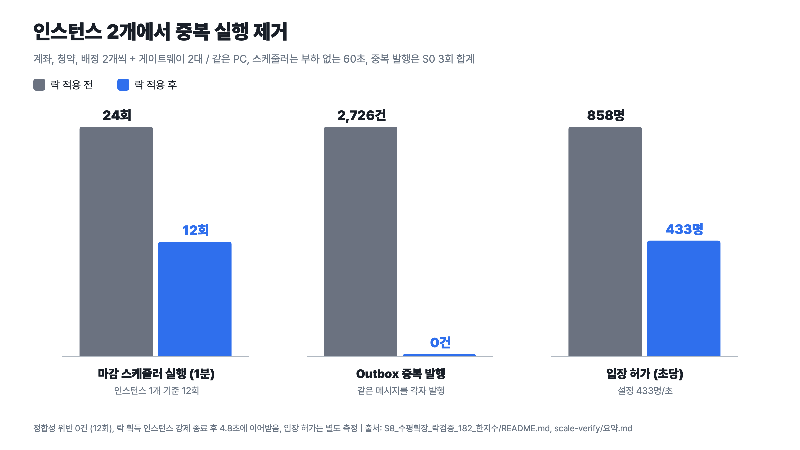

- **문제**: 계좌, 청약, 배정 인스턴스 2개 + 게이트웨이 2대에서 측정하니 인스턴스마다 같은 작업을 실행
  - 마감 스케줄러 1분 실행 12회 → 24회
  - Outbox 발행기가 같은 미발행 행을 각자 발행해 중복 발행 2,726건 (부하 3회 합계)
  - 게이트웨이마다 입장 처리를 실행해 입장 속도 433명/초 → 858명/초
- **해결**
  - 스케줄러, Outbox 발행기: ShedLock으로 여러 인스턴스의 동시 실행을 제한
    - Outbox 발행기는 락 만료(1분) 전에 전송이 끝나도록, 1회 실행에서 새 전송을 30초까지만 시작
    - 그래도 발생 가능한 중복 수신은 Consumer 멱등 처리로 대응
  - 입장 처리: 1초 단위 Redis 키를 먼저 생성한 게이트웨이 1대만 처리
- **결과**: 스케줄러 1분 24회 → 12회, 중복 발행 2,726건 → 0건, 입장 858명/초 → 433명/초, 정합성 위반 0건 (12회)
  - 락을 획득한 인스턴스를 강제 종료하자 4.8초 후 다른 인스턴스가 락 획득
- **한계**: Outbox 발행 처리량은 인스턴스 수를 증가시켜도 1개일 때와 동일함

</details>

<details>
<summary><b>경쟁률을 조회했을 뿐인데, 청약 응답이 29초까지 증가했다</b><br><sub>청약 응답 p95 29.0초 → 70ms</sub></summary>
<br>

**관련 서비스**: subscription-service  
**담당**: [이창열](https://github.com/askl690)  
**PR**: [#170](https://github.com/gongmoju-4jo/ipo-subscription/pull/170), [#180](https://github.com/gongmoju-4jo/ipo-subscription/pull/180)

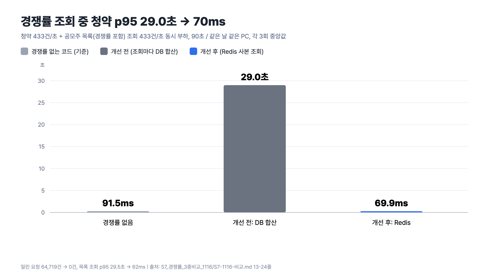

- **문제**: 청약과 공모주 목록 조회를 동시에 거는 시나리오에서 청약 응답 p95가 29.0초  
  목록을 조회할 때마다 경쟁률을 DB에서 합산하고 있었음
- **원인**: 합산 쿼리가 평균 421ms 걸리며 PostgreSQL CPU 상한에 도달  
  합산 쿼리 실행 중 청약 서비스 커넥션 30개가 모두 사용 중이었음
- **해결**: 경쟁률은 Redis 캐시에서 조회하고, 기준값은 DB에 유지  
  캐시가 비면 DB로 다시 계산하고, 경쟁률 캐시 조회에 실패해도 청약 접수에 영향을 주지 않도록 분리함
- **결과**: 청약 p95 29.0초 → 70ms, 지연된 요청 64,719건 → 0건
- **한계**: 경쟁률 캐시 조회에 실패하면 경쟁률을 DB로 계산해, DB 부하가 다시 증가할 수 있음 (측정하지 않음)

</details>

<details>
<summary><b>대기열에서 사라진 사용자, 원인은 Redis 명령 순서</b><br><sub>입장 허가 저장 실패 시 대기자 유실 방지</sub></summary>
<br>

**관련 서비스**: api-gateway  
**담당**: [김진우](https://github.com/Kimjinwoo99)  
**PR**: [#130](https://github.com/gongmoju-4jo/ipo-subscription/pull/130)

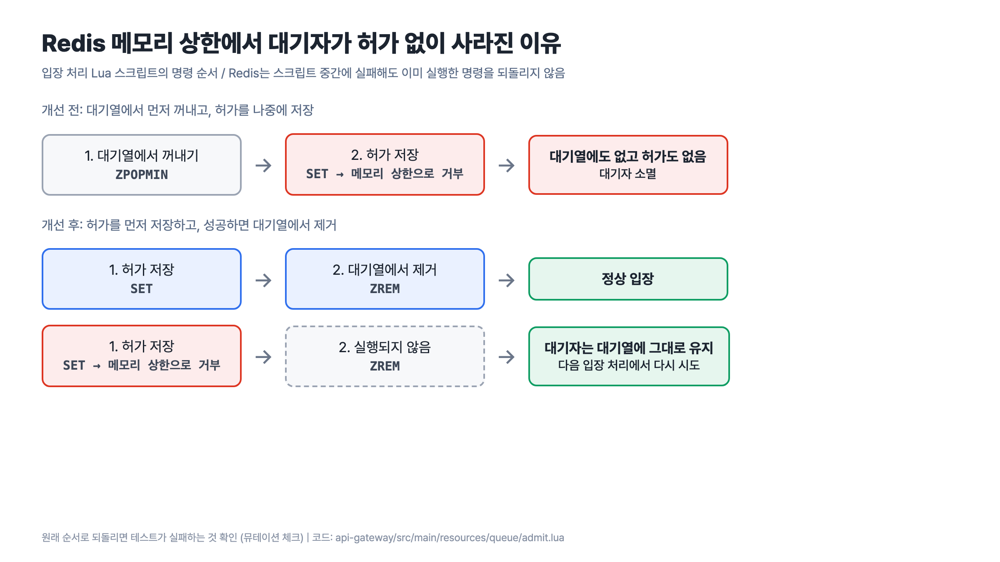

- **문제**: Redis 메모리 상한에서 대기자가 입장 허가를 받지 못한 채 대기열에서 삭제됨
- **원인**: 입장 처리 Lua 스크립트가 대기열에서 먼저 꺼내고(ZPOPMIN) 허가를 나중에 저장(SET)  
  메모리 상한에서 SET만 거부되고, 이미 실행한 ZPOPMIN은 되돌려지지 않음
- **해결**: 허가를 먼저 저장(SET)하고, 성공하면 대기열에서 제거(ZREM)하도록 순서 변경  
  SET이 거부되면 대기자는 대기열에 그대로 남음
- **결과**: 메모리 상한에서 허가 저장이 거부돼도 대기자가 대기열에 남음 ([테스트](api-gateway/src/test/java/com/gongmoju/gateway/queue/AdmissionSchedulerTest.java))

</details>

<br>

## Tech Stack

     
     
    
    
      
     
 

<br>

## ERD

<div align="left">
  
</div>

<br>

## Getting Started

필요: JDK 21, Docker (메모리 6GB 이상 권장), Node.js  
Windows는 Docker Desktop과 Git Bash에서 아래 명령을 그대로 실행합니다.

```bash
cp .env.example .env          # DB 비밀번호 4개, JWT_SECRET, GRAFANA_ADMIN_PASSWORD 입력
./gradlew build -x test
docker-compose up -d --build
cd frontend
npm install
npm run dev                   # http://localhost:5173
```

- 통합 Swagger: `localhost:8080/swagger-ui/index.html`
- Grafana `localhost:3000`, Kafka UI `localhost:8989`, Zipkin `localhost:9411`

자세한 내용은 [프로젝트 세팅 가이드](docs/PROJECT_SETUP.md), [부하 테스트 가이드](docs/LOADTEST.md), [유비쿼터스 언어](docs/UBIQUITOUS_LANGUAGE.md), [GitHub 협업 가이드](docs/GITHUB_GUIDE.md)

<br>

## Contributors

| [한지수](https://github.com/eldeoddt) | [김진우](https://github.com/Kimjinwoo99) | [이승훈](https://github.com/tcrnela) | [이창열](https://github.com/askl690) | [최승근](https://github.com/choiseungkeun) |
| --- | --- | --- | --- | --- |
|  |  |  |  |  |
| `Team Lead`<br>**계좌**<br>- 증거금, 원장<br>- 정산, 환불<br>- 원장 대사<br>- 정합성 검증 | **인프라**<br>- 회원, 인증<br>- 접속 대기열<br>- 모니터링<br>- AWS 배포 | **배정**<br>- 균등, 비례, 추첨<br>- 대량 배정<br>- 추첨 재현<br>- ShedLock | **청약 접수**<br>- 공모주, 청약 API<br>- 마감, 접수 Outbox<br>- 경쟁률 캐시<br>- 키셋 조회 | **SAGA**<br>- 오케스트레이터<br>- 보상 트랜잭션<br>- 반환 백오프<br>- 장애 주입 검증 |
